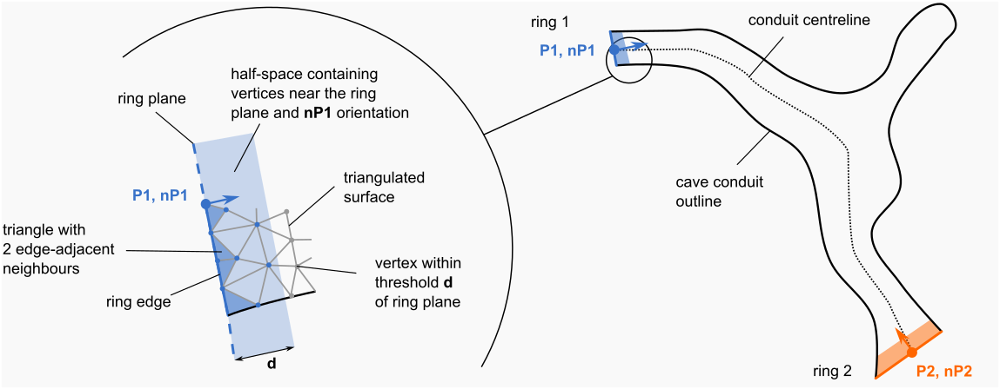
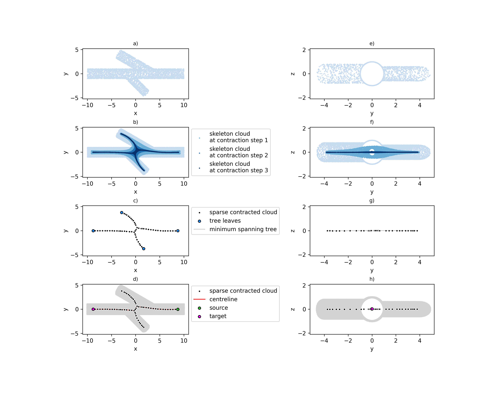
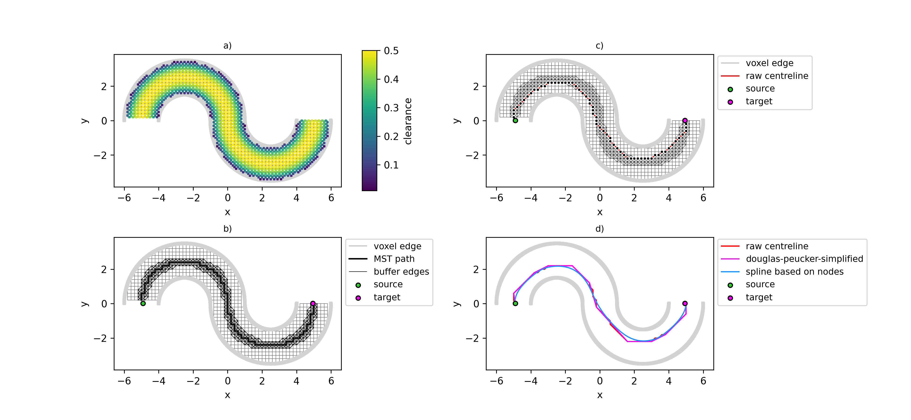
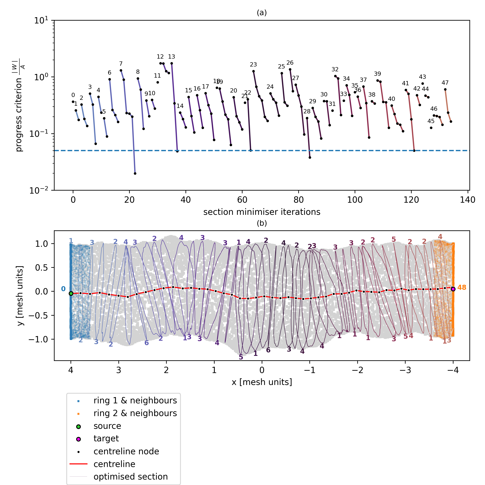
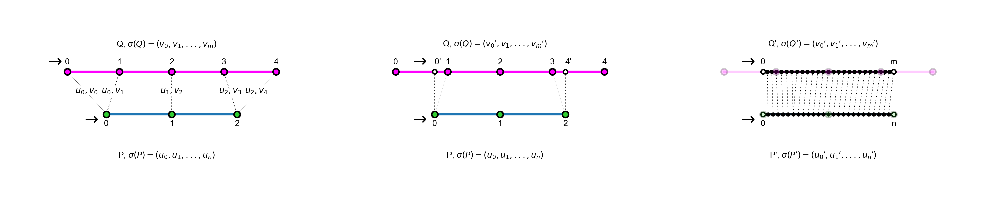

# pc-centrelines

A collection of routines for the extraction of centrelines from unstructured point cloud data.

[](https://doi.org/10.5281/zenodo.23564371)


[](https://github.com/ERC-Karst/pc-centrelines/actions/workflows/python-app.yml)


This is a companion to the publication entitled: 

```
Tanguy Racine, Ismail El Mellas, Benoît Noetinger, Otfried Cheong, Sergio Cabello and Philippe Renard, 2027, Modelling cave conduit centrelines: a comparison of hydraulic and geometric approaches.
```

We provide several methods for traversing a cave conduit from inlet to outlet, recording the trajectory along the way (the centreline). This is related to computing the curve skeleton of a 3D object, as will be evident in following approaches.

## Installation and troubleshooting

### Cloning this repository

Open e.g. the Git Bash App and type: 

```
git clone https://github.com/ERC-Karst/pc-centrelines.git
```

### Setting up the pc-centrelines environment

The [environment.yml](environment.yml) file contains the necessary python packages for running the code. 

To set-up the python environment with conda or miniconda, you may first navigate to ``pc-centrelines`` repository you may run:

```
conda env create --file=environment.yml
```
See: [Managing conda environments](https://docs.conda.io/projects/conda/en/stable/user-guide/tasks/manage-environments.html) for details.

Activate the pc-centrelines environment by entering: 

```
conda activate pc-centrelines
```

### Installing the package with pip

To install the package pc_centrelines in the pc-centrelines, you may first navigate to ``pc-centrelines`` repository you may run:

```
pip install -e .
```

With the pc-centrelines environment active, you may then call all the functions using the following import syntax: 

```
import pc_centrelines as pcc
```


### Voxeliser and B-spliner

These executables are written in C++ need to be compiled with a C++ compiler, e.g. gcc

These also call on a series of C++ libraries for handling meshes, pointclouds and basic geometric tools now located in clibs.

Navigate to ```./pc-centrelines/src/pc_centrelines/centreliner``` and run ````make ``` to compile the following executables: ``voxelize.exe`` and ``bspliner.exe`` 

## Example codes

### Inlets and outlets 

Assuming the triangulated surface contains two large holes corresponding to the inlet and outlet faces of a flow simulation we need identify two sequence of edges which form a closed planar curve. 
We first build a triangle edge-adjacency matrix and identify therein all triangles with only two edge-neighbours. On these "edge" triangles, we find the only distinct pair of vertices not shared by an edge-adjacent triangle: these define a ring segment. We search for all possible ring edges on a surface and separate them into contiguous sets. For each of the rings, we compute their containing plane, defined a mean coordinate $\mathbf{P_n}$ and a vector normal to the plane $\mathbf{{n_P}_n}$. 
To identify the direction in which the cave interior lies, we select vertices within a given distance d from the ring and then choose the sign of the coordinates for the normal vector $\mathbf{n_P}$. 


_Example of contraction steps on the branching conduit_

This is implemented in [Find inlet and outlet](notebooks/0_find_inlet_and_outlet.ipynb)


### Laplacian-based-contraction 

- contract mesh vertices
- subsample skeleton cloud
- generate Minimum Spanning Tree on euclidean distance
- find longest path between any two leaves

This is the centreline.


_Example of contraction steps on the branching conduit_

This is implemented in [Demonstrate LBC Contraction](notebooks/1_demonstrate_LBC_contraction.ipynb)


### voxel-based approach

- voxelise the cave conduit interior
- build a metric graph of the cubic lattice supported by voxel edges
- compute clearance at each edge midpoint and assign this as a weight to the cubic lattice edges
- build a Maximum Spanning Tree (MaxST) on the weighted graph
- identify source and outlet, and find a path on the MaxST between these nodes
- grow a buffer zone around this shortest path using 26-neighbour adjacency
- find shortest path from source to outlet
- apply smoothing procedure e.g. b-splines

This is the centreline. 


_Example of the voxel-based approach on the sinuous case_


This is implemented in [Demonstrate voxel-based Approach](notebooks/2_demonstrate_voxel_based_centreline.ipynb)


### Iterative section finder

- identify a source point and an itinial direction 
- for each step:
    - update the walker position by stepping in this direction
    - compute the intersection of the cave conduit with the plane
    - minimise the area with respect to the plane-normal orientation by fixed-step gradient descent (criterion: $\frac{\mid W\mid }{A}$)
    - update the walker position to the barycentre of the optimal section
    - append the centreline with the current point, optimal section (closed planar curve) and the associated vector 

This is the centreline. 


_Example of the iterative stepper approach for the rough case_


This is implemented in [Demonstrate the iterative pathfinder](notebooks/3_demonstrate_iterative_pathfinder.ipynb)

### Fréchet metric

We use the discrete Fréchet metric to determine the distance between any two generated centrelines.

Here, P and Q represent two centrelines as polylines, formalised as a sequence of linear segments. 
Following the notation of \cite{eiter1994computing}, then the sequence $\sigma(P) = (u_1, u_2,...u_n)$, $\sigma(Q) = (v_1, v_2, ..., v_m)$  represents the sequence of $
p$ and $q$ points in P and Q respectively. 


A coupling L between P and Q is denoted as the following sequence: 
$L_{P,Q} = ({u_{a_1}}, {v_{b_1}}), ({u_{a_2}}, {v_{b_2}}),..., ({u_{a_n}}, {v_{b_m}})$
of distinct pairs from $\sigma (P) \times \sigma(Q)$ such that $a_1 = 1$, $b_1 = 1$, $a_n = p$, $b_m = q$, and for
all $i = 1,...,q$ we have $a_{i+1} = a_i$ or $a_{i+1} = a_i + 1$, and $b_{i+1} = b_i$ or $b_{i+1} = b_i + 1$.
A coupling between these two curves has to respect the order of vertices in P and Q



_Example of various couplings between polylines_

This is implemented in [Demonstrate Fréchet metric pitfalls](notebooks/8_demonstrate_discrete_frechet_pitfalls.ipynb) notebook.


### Wasserstein-1 distance

Using the centrelines generated by the above algorithms, we also computed the closed-planar curves representing intersection between conduit meshes and planes defined by a vector tangent to the curve skeleton.

We explore the sensitivity of descriptor distribution regarding the choice of centrelining process by calculating the Wasserstein - or Earth Mover's ($l_1 (u, v)$) distance between two distributions $u$ and $v$ of geometric descriptors. 
This metric is defined as: 

$$
l_1(u, v) =  \int_{-\infty}^{+\infty} |U-V| 
$$

Here $u$ refers to the distribution of descriptors calculated using the analytic datums and associated tangent vectors as a benchmark, while $v$ represents the distribution of descriptors associated with a specific centrelining algorithm and the tangent vector approximation.
In the above equation $U$ and $V$ represent their respective cumulative distribution functions.   

This is demonstrated in the [Conduit Heuristics](notebooks/9_conduit_heuristics.ipynb) notebook.

